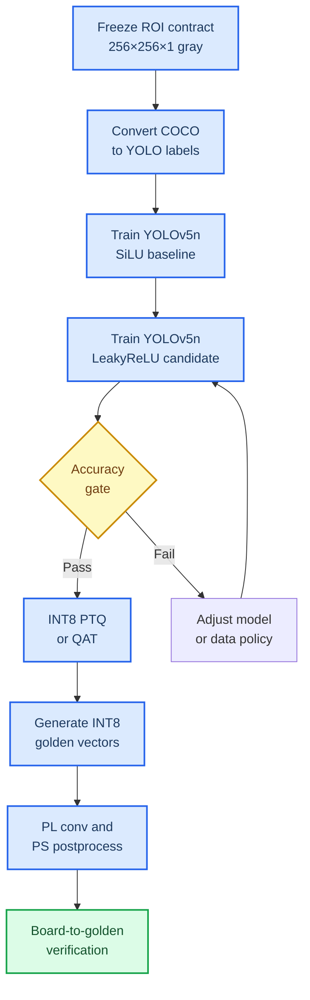

# YOLOv5n ZYNQ-7010 训练迁移计划

_GC10 十类缺陷检测：从软件精度基线到 OV5640 / ZYNQ-7010 可部署 INT8 模型的唯一训练路线。_

---

## 📌 目标与边界

目标是在不改变现场视频输入约束的前提下，获得一个可验证、可量化、可切分到 PS/PL 的检测模型。

| 项目 | 固定值 |
| --- | --- |
| 板卡 | ZYNQ-7010，XC7Z010CLG400-1 |
| PL 资源边界 | 80 DSP、2.1 Mbit BRAM、DDR3 512 MB |
| 视频输入 | OV5640 DVP：`D[7:0]`、`PCLK`、`HREF`、`VSYNC` |
| 视频帧 | `640×480` |
| AI 输入 | 锁定 ROI 后 `256×256×1` INT8 灰度图 |
| 数据集 | GC10-DET-YOLO-ROI256，10 类，train/val/test = 2421/344/344 |
| 软件上限模型 | YOLOv5n-SiLU，单通道灰度 |
| 部署候选模型 | YOLOv5n-Z7010-LeakyReLU，负斜率 `1/8` |

> ⚠️ 不允许使用 RGB `640×640` 的训练结果直接部署。PC 训练、INT8 Golden Model 和 PL 输入必须使用同一 ROI、灰度公式、Resize 规则与 `256×256×1` 张量契约。

## 🧭 训练与部署流程



## 🧱 阶段 0：冻结数据与图像接口

### 输入数据流

```text
OV5640 DVP 640×480
→ PL Camera RX / CDC
→ Gray
→ CCL / Tracking / Inspection Zone
→ Triple Buffer 锁定帧
→ ROI Crop
→ Resize 256×256
→ uint8 灰度 AI 输入
```

### 必须产出的文件

- `gc10_yolo.yaml`：10 类名称、训练/验证/测试路径
- `images/train|val|test`：灰度训练图或训练时等价灰度变换入口
- `labels/train|val|test/*.txt`：YOLO 标签
- `data_contract.md`：灰度、ROI、Resize、归一化和类别映射说明

### 验收

- [x] 每一张 COCO 图只属于一个 split
- [x] 每个 YOLO 标签类别为 `0..9`
- [x] bbox 满足 `0 < w,h <= 1` 且中心点在 `[0,1]`
- [ ] PC 参考 Resize 与 PL Resize 使用同一种插值和边界规则
- [x] 随机抽取 20 张图，COCO bbox 与 YOLO bbox 往返误差不超过 1 像素

## 🧪 阶段 1：YOLOv5n-SiLU 软件精度基线

### 模型约束

使用现成 YOLOv5n 训练、损失、Anchor、增强和 COCO 指标流程，但配置为：

```text
Input channel = 1
Input size = 256
Classes = 10
Activation = SiLU
Detection scales = stride 8 / 16 / 32
```

SiLU 模型只用于回答“GC10 在成熟检测框架下的精度上限是多少”，不作为 RTL 直接实现目标。[^1]

### 固定训练记录

每个 run 必须保存：

- 完整超参数与 Git revision
- 训练/验证 loss 曲线
- `mAP50:95`、`mAP50`、Precision、Recall
- 逐类 AP50、逐类 Recall
- `best.pt`、`last.pt`
- val 集预测可视化和混淆矩阵

### 阶段通过条件

- [ ] 10 类均输出独立指标
- [ ] 无类别因标签转换错误而缺失
- [ ] 结果作为后续 LeakyReLU 与 INT8 的唯一对照基线

## ⚙️ 阶段 2：YOLOv5n-Z7010-LeakyReLU 对照训练

### 唯一结构变化

```text
Baseline: Conv → BN → SiLU
Candidate: Conv → BN → LeakyReLU(1/8)
```

定点实现规则：

```text
if x >= 0: y = x
else:      y = arithmetic_right_shift(x, 3)
```

除激活函数外，数据、输入、增强、Anchor、epoch、batch size、学习率、随机种子、NMS 阈值和评估脚本必须与阶段 1 相同。

### 选择门槛

| 指标 | 部署候选的要求 |
| --- | --- |
| 总 `mAP50:95` | 相比 SiLU 绝对下降不超过 `0.03` |
| 关键类别 AP50 | 不出现由有效结果降为近零的类别 |
| Recall | 不显著低于 SiLU 基线 |
| 推理输出 | 三尺度 Head 契约稳定 |

若未通过，依次只尝试一个变量：增加通道、调整输入 ROI、使用 ReLU6 或 Hard-Swish；每次都与阶段 1 基线比较，不允许同时改变多个变量。

## 🔢 阶段 3：INT8 量化与 Golden Model

### 顺序

```text
LeakyReLU FP32 best.pt
→ BN Fold
→ PTQ 校准与 val 评估
→ 若精度不满足门槛，QAT
→ 冻结 INT8 参数
→ 生成每层 Golden 向量
```

### 定点契约

| 对象 | 格式 |
| --- | --- |
| 权重 | INT8，per-channel scale |
| 激活 | INT8，per-tensor scale |
| 累加 | INT32 |
| BN | Fold 到 Conv weight 和 bias |
| Requant | `INT32 × multiplier >> shift`，饱和到 INT8 |
| 激活 | LeakyReLU `1/8` 定点移位 |

### 量化通过条件

- [ ] INT8 的 `mAP50:95` 相比 LeakyReLU FP32 绝对下降不超过 `0.02`
- [ ] 每类 AP50 无异常归零
- [ ] 每层导出 input、weight、bias、multiplier、shift、output
- [ ] Golden Model 对固定输入可重复输出相同的 INT8 张量

## 🔌 阶段 4：PS/PL 接口与板端验收

### PL 责任

```text
Camera RX / CDC
Gray / ROI / Resize
INT8 3×3 and 1×1 Conv
BN Fold / Bias / Requant
LeakyReLU
MaxPool / Upsample / Concat
三尺度原始检测头输出
```

### PS 责任

```text
AXI DMA 调度
Sigmoid 查表
Anchor Decode
Confidence Filter
Top-K（建议先限制到 200）
C/C++ NMS
PASS / FAIL
HDMI 叠框、GPIO / PLC
```

256 输入、10 类、每尺度 3 Anchor 时，每个检测尺度的通道数为 `3 × (4 + 1 + 10) = 45`：

```text
32×32×45
16×16×45
8×8×45
```

PS 只接收三尺度检测输出，不能把大中间特征图在 PL 与 PS 间反复搬运。

### 对拍顺序

1. PyTorch FP32 与 INT8 Golden Model
2. INT8 Golden Model 与单层 RTL
3. INT8 Golden Model 与 PL 多层输出
4. PL 原始 Head 输出与 PS Decode
5. PC 参考结果与板端 bbox、类别、置信度
6. OV5640 实时视频、ROI 锁定、HDMI、PASS/FAIL 联调

## 📊 最终验收矩阵

| 层级 | 必须证明的事实 |
| --- | --- |
| 数据 | COCO→YOLO 无漏标、无错类、无 split 泄漏 |
| 模型 | SiLU 基线和 LeakyReLU 候选均有逐类指标 |
| 量化 | INT8 精度下降可量化且受控 |
| RTL | 定点输出与 Golden Model 一致 |
| PS | Top-K、NMS 与参考实现一致 |
| 系统 | 640×480 视频流中一次工件只触发一次推理 |
| 交付 | HDMI bbox、类别、置信度与 PASS/FAIL 正确 |

## 参考资料

[^1]: Ultralytics. "YOLOv5." GitHub. https://github.com/ultralytics/yolov5
